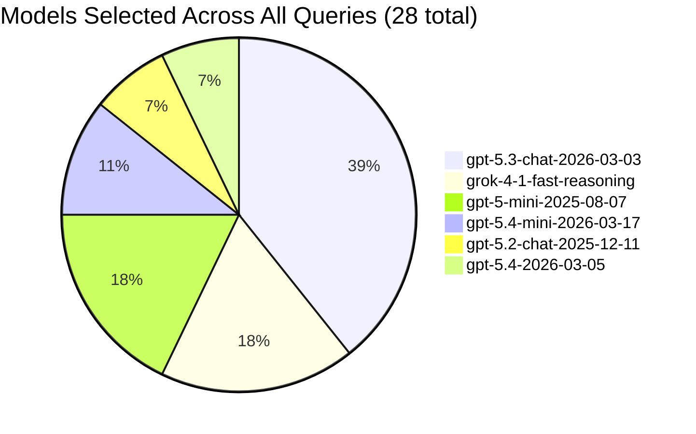
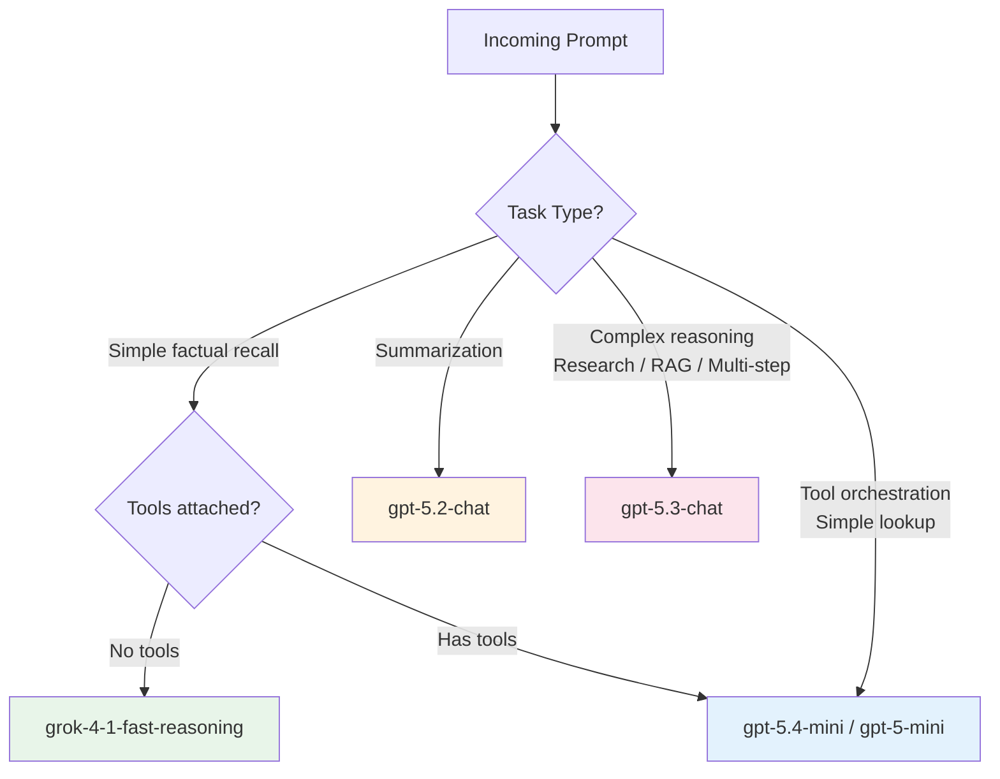
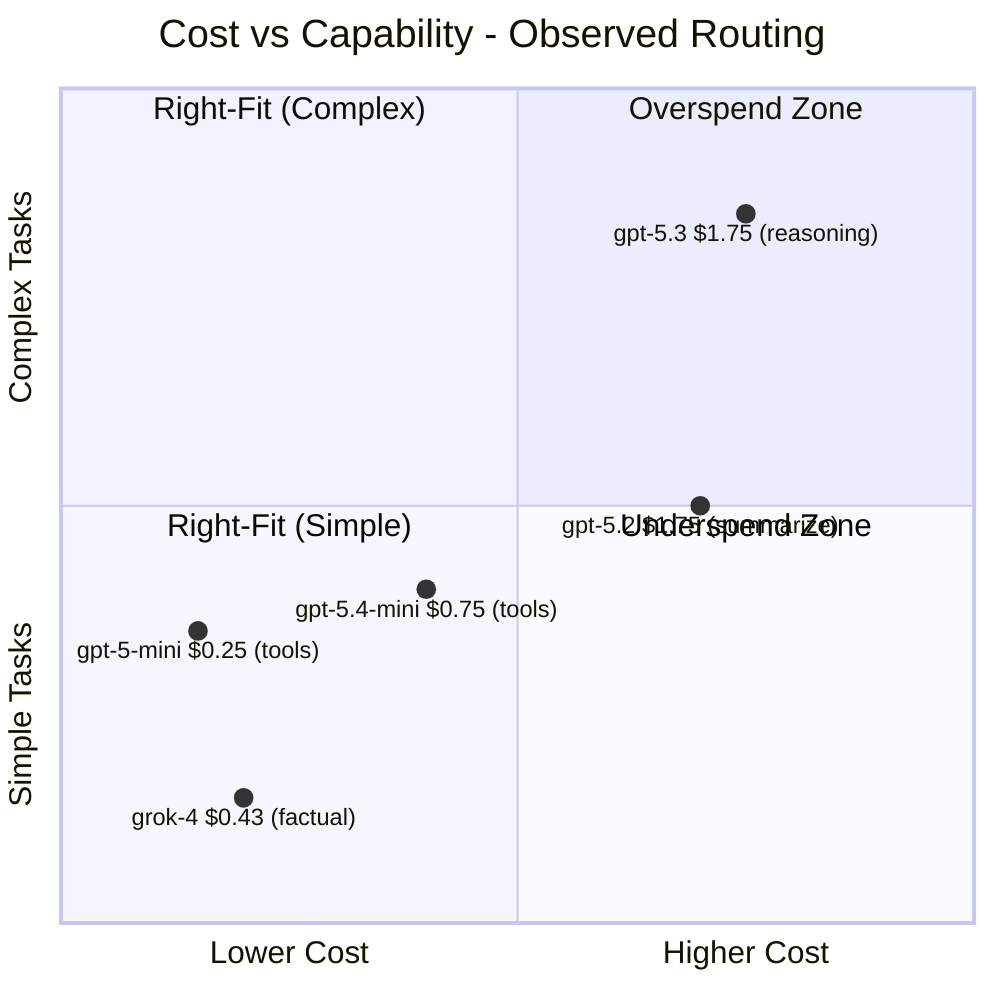

# Model Router: Let Your Agent Pick Its Brain

## The Model Selection Problem

Building AI agents today means choosing from 20+ available models — GPT-5 variants, Grok, Claude, DeepSeek, Llama, and more. Each has different strengths, costs, and latency profiles. Traditional approaches require:

- Deploying multiple models separately
- Writing routing logic in your application
- Maintaining selection criteria as models evolve
- Accepting cost inefficiency (using expensive models for simple tasks)

**Model router** eliminates this entirely. You deploy one endpoint (`model-router`), write zero routing code, and the router selects the optimal model for each request in real time — balancing quality against cost.

This article presents **empirical evidence** from progressively complex Azure AI Foundry agent demos, all using the same `model-router` deployment. We observe which models the router selects and why.

> **Reference:** [Model Router for Microsoft Foundry](https://learn.microsoft.com/en-us/azure/foundry/openai/concepts/model-router) — official conceptual documentation.

---

## Agents: Multiple Agents and Tools with Model Router

Multiple agents optionally with tools, share the same model:

```
MODEL_DEPLOYMENT=model-router
```

No model pinning, no routing hints, no per-scenario configuration. The only variables are the agent's tools, system prompt, and the user's query.

| # | Agent | Tools | Domain | Task Complexity | Model Selected |
|---|-------|-------|--------|-----------------|----------------|
| 0 | Hello-Agent | None | General chat | Low — simple Q&A | grok-4-1-fast-reasoning, gpt-5.2-chat-2025-12-11 |
| 1 | Weather-Agent | FunctionTool (get_weather) | Weather lookup | Low-Medium — tool orchestration | gpt-5.4-mini-2026-03-17, gpt-5-mini-2025-08-07 |
| 2 | Desktop-Agent | None | General chat (GUI) | Low — same as Demo 0, different UI | grok-4-1-fast-reasoning, gpt-5.2-chat-2025-12-11 |
| 3 | Search-Agent | WebSearchTool | Current events/research | Medium — real-time info retrieval | gpt-5-mini-2025-08-07, gpt-5.3-chat-2026-03-03 |
| 4 | Code-Agent | CodeInterpreterTool | Data analysis/computation | Medium-High — code generation + execution | gpt-5.4-2026-03-05, gpt-5-mini-2025-08-07 |
| 5 | RAG-Agent | FileSearchTool + vector store | HR policy (document grounding) | Medium — retrieval + synthesis | gpt-5.3-chat-2026-03-03 |
| 6 | MCP-Agent | MCPTool (GitHub) | GitHub operations | Medium-High — external service orchestration | gpt-5-mini-2025-08-07, gpt-5.3-chat-2026-03-03 |
| 7 | Toolbox-Agent | Toolbox (GitHub Issues + Repos) | GitHub issues & repos (curated) | Medium-High — curated multi-tool orchestration | gpt-5.3-chat-2026-03-03, gpt-5.4-mini-2026-03-17, gpt-5.4-2026-03-05 |

---

## Prompts: What Model Router Actually Chose

### Raw Observations

| Demo | Query | Task Type | Complexity | Model Selected |
|------|-------|-----------|------------|----------------|
| 0 - hello | "What's the capital of WA state?" | Factual recall | Low | grok-4-1-fast-reasoning |
| 0 - hello | "Name three fun facts" | Creative/knowledge | Low | grok-4-1-fast-reasoning |
| 0 - hello | "I meant about Olympia" | Follow-up/clarification | Low | grok-4-1-fast-reasoning |
| 0 - hello | "Summarize our conversation" | Summarization | Medium | gpt-5.2-chat-2025-12-11 |
| 1 - tools | "Who wrote Hamlet?" | Factual recall | Low | gpt-5.4-mini-2026-03-17 |
| 1 - tools | "What's the weather in Seattle?" | Tool-using | Low-Medium | gpt-5.4-mini-2026-03-17 |
| 1 - tools | "Compare with Dubai" | Follow-up + tool | Medium | gpt-5-mini-2025-08-07 |
| 2 - desktop | "What's the capital of Japan?" | Factual recall | Low | grok-4-1-fast-reasoning |
| 2 - desktop | "Three fun facts about it" | Creative/knowledge | Low | grok-4-1-fast-reasoning |
| 2 - desktop | "Summarize our conversation" | Summarization | Medium | gpt-5.2-chat-2025-12-11 |
| 3 - websearch | "What's the capital of WA state?" | Factual (with search available) | Low | gpt-5-mini-2025-08-07 |
| 3 - websearch | "What's today's top news from Seattle?" | Research/current events | Medium-High | gpt-5.3-chat-2026-03-03 |
| 4 - code | "Calculate the first 20 Fibonacci numbers and show them in a table" | Code generation + execution | Medium | gpt-5.4-2026-03-05 |
| 4 - code | "What's the standard deviation of [23, 45, 12, 67, 34, 89, 56]?" | Computation | Low-Medium | gpt-5-mini-2025-08-07 |
| 4 - code | "Create a bar chart comparing the populations of the top 5 most populous countries" | Code generation + visualization | Medium-High | gpt-5-mini-2025-08-07 |
| 5 - rag | "How many PTO days do new employees get?" | Document retrieval + synthesis | Medium | gpt-5.3-chat-2026-03-03 |
| 5 - rag | "What's the company's stock price?" | Out-of-scope query | Low | gpt-5.3-chat-2026-03-03 |
| 5 - rag | "What's Microsoft stock price?" | Out-of-scope query | Low | gpt-5.3-chat-2026-03-03 |
| 5 - rag | "Can I work from home 5 days a week?" | Document retrieval + synthesis | Medium | gpt-5.3-chat-2026-03-03 |
| 5 - rag | "What's the 401k match?" | Document retrieval + synthesis | Medium | gpt-5.3-chat-2026-03-03 |
| 6 - mcp | "What's my GitHub username?" | External tool (simple) | Low-Medium | gpt-5-mini-2025-08-07 |
| 6 - mcp | "Top 5 repositories about Microsoft Foundry?" | External tool (complex search) | Medium-High | gpt-5.3-chat-2026-03-03 |
| 6 - mcp | "List five repositories that mention 'model router'" | External tool (complex search) | Medium-High | gpt-5.3-chat-2026-03-03 |
| 6 - mcp | "I meant specifically Microsoft model router" | Follow-up + external tool | Medium-High | gpt-5.3-chat-2026-03-03 |
| 7 - toolbox | "Search for issues labeled bug in microsoft/vscode" | Curated tool (issues) | Medium-High | gpt-5.3-chat-2026-03-03 |
| 7 - toolbox | "List my repos in GitHub" | Conversational (needs username) | Low | gpt-5.3-chat-2026-03-03 |
| 7 - toolbox | "<username>" (search repos for user) | Curated tool (repos) | Medium | gpt-5.4-mini-2026-03-17 |
| 7 - toolbox | "Summarize our conversation" | Summarization | Medium | gpt-5.4-2026-03-05 |

### Model Distribution



### Observed Routing Logic



---

## Analysis: Routing Patterns

### Pattern 1: Fast Models for Simple Facts

When the query is straightforward factual recall ("What's the capital of...?", "Name three fun facts"), the router selects **grok-4-1-fast-reasoning** — a model optimized for speed on simple knowledge tasks. This happened consistently across Demo 0 and Demo 2, regardless of UI layer.

**Implication:** Simple queries never touch expensive reasoning models. Cost savings are immediate.

### Pattern 2: Mini Models for Tool Orchestration

When agents have tools attached but the task is mechanistic (call a function, pass arguments, format the result), the router selects **gpt-5-mini** or **gpt-5.4-mini**. These models are capable enough to generate valid tool calls with `strict=True` JSON, but cost a fraction of full-size models.

**Implication:** Tool-using agents don't need expensive models for the routing/orchestration layer.

### Pattern 3: Full Models for Complex Reasoning

Research queries, RAG synthesis, and multi-step external tool operations consistently route to **gpt-5.3-chat** — a full-capability model suited for complex reasoning, information synthesis, and nuanced answers.

**Implication:** Complex tasks automatically get the capacity they need, without manual escalation.

### Pattern 4: Specialized Models for Specific Tasks

Summarization — even within a conversation that started with a fast model — routes to **gpt-5.2-chat**. This was 100% consistent: every "summarize our conversation" request selected the same model, regardless of which demo or agent was running.

**Implication:** The router recognizes task categories (not just complexity) and picks purpose-built models.

### Pattern 5: Multi-Model Conversations

The most striking observation: **different turns in the same conversation can use different models**. A conversation might start with `grok-4-1-fast-reasoning` for "What's the capital of Japan?", continue with the same model for "Fun facts about Tokyo", then switch to `gpt-5.2-chat` for "Summarize our conversation."

**Implication:** Model selection is per-request, not per-session. Each turn gets the optimal model independently.

---

## Cost Implications

### Actual Retail Pricing (Global Standard, per 1M tokens)

| Model (as observed) | Input | Output | Source |
|---------------------|-------|--------|--------|
| gpt-5-mini | $0.25 | $2.00 | [pricing.json](./data/pricing.json) |
| grok-4-fast-reasoning | $0.43 | $1.73 | [pricing.json](./data/pricing.json) |
| gpt-5.4-mini | $0.75 | $4.50 | [Azure OpenAI Pricing](https://azure.microsoft.com/en-us/pricing/details/cognitive-services/openai-service/) |
| gpt-5.2-chat | $1.75 | $14.00 | [Azure OpenAI Pricing](https://azure.microsoft.com/en-us/pricing/details/cognitive-services/openai-service/) |
| gpt-5.3-chat | $1.75 | $14.00 | [Azure OpenAI Pricing](https://azure.microsoft.com/en-us/pricing/details/cognitive-services/openai-service/) |

### The 7x Cost Delta

The cheapest model selected (gpt-5-mini) costs **$0.25/1M input tokens**.  
The most expensive model selected (gpt-5.3-chat) costs **$1.75/1M input tokens**.  
Grok-4-fast-reasoning sits at **$0.43/1M** — still 4x cheaper than the full models.

That's a **7x difference on input** and **7x on output** ($2 vs $14 per 1M tokens) between the cheapest and most expensive tiers the router selected.



### What "Over-Provisioning" Actually Costs

Without model-router, developers typically:
- **Over-provision**: Use GPT-5.3 for everything → works, but **7x the cost** for simple queries that gpt-5-mini handles equally well
- **Under-provision**: Use GPT-5-mini for everything → cheap, but quality degrades on complex reasoning and synthesis tasks
- **Manual routing**: Write if/else logic based on heuristics → fragile, doesn't generalize, maintenance burden

Model-router lands every query in the "right-fit" zone automatically.

### Estimated Savings From Our 15 Queries

| Tier | Queries | % | Model | Input $/1M |
|------|---------|---|-------|------------|
| Cheapest | 3 | 20% | gpt-5-mini | $0.25 |
| Low | 4 | 27% | grok-4-fast | $0.43 |
| Mid | 2 | 13% | gpt-5.4-mini | $0.75 |
| Full | 6 | 40% | gpt-5.2-chat / gpt-5.3-chat | $1.75 |

**If all 15 had used gpt-5.3-chat**: Every query billed at $1.75/1M input + $14/1M output.  
**With model-router**: 60% of queries (9 of 15) routed to models costing 2x–7x less — with equivalent quality for those tasks.

For a production agent handling thousands of requests/day where 60%+ are simple lookups or tool calls, this compounds into significant savings.

---

## What You'd Build Without Model Router

To replicate model-router's behavior manually, you'd need:

```
1. Deploy 4-5 models separately
   - grok-4-fast-reasoning
   - gpt-5-mini
   - gpt-5.2-chat
   - gpt-5.3-chat
   - gpt-5.4-mini

2. Write a prompt classifier
   - Categorize by task type (factual, creative, summarization, reasoning)
   - Estimate complexity (token count, question depth, tool requirements)
   - Handle ambiguous cases

3. Build a routing table
   - Map (task_type, complexity, tools_available) → model
   - Tune thresholds over time

4. Handle failover
   - What if gpt-5.3 is throttled? Fall back to what?
   - Maintain priority queues per model

5. Update routing logic every time a new model releases
   - Is gpt-5.4 better than gpt-5.3 for summarization?
   - Run evaluations, update rules

6. A/B test model selections
   - Are your heuristics actually optimal?
   - Monitor quality regressions
```

With model-router, all of this is **one line**:

```python
MODEL_DEPLOYMENT = "model-router"
```

The router is itself a trained language model that does steps 2-6 automatically, updated with each new version.

---

## Alignment with Official Routing Modes

Our observations used the **Balanced** mode (default). The [official documentation](https://learn.microsoft.com/en-us/azure/foundry/openai/concepts/model-router) describes three modes:

| Mode | Behavior | Quality Band | Best For |
|------|----------|--------------|----------|
| **Balanced** (our test) | Picks most cost-effective model within 1-2% of best quality | Narrow | General-purpose agents |
| **Quality** | Always picks highest-quality model | N/A — always top | Critical reasoning, high-stakes outputs |
| **Cost** | Picks cheapest model within 5-6% of best quality | Wide | High-volume, budget-sensitive workloads |

Our data confirms the Balanced mode's behavior: the router never used an expensive model when a cheaper one was within quality tolerance for the task.

### Additional Features Observed

- **Automatic failover**: Built-in — no configuration needed
- **Prompt caching**: Works transparently when the same model handles consecutive requests
- **Tool support**: Confirmed working with all 5 tool types (FunctionTool, WebSearchTool, CodeInterpreterTool, FileSearchTool, MCPTool)

---

## Key Takeaways

1. **Zero routing code required** — Same `model-router` deployment works for CLI chat, GUI apps, tool-calling agents, RAG, and MCP integration

2. **Per-request optimization** — Different turns in the same conversation can use different models based on that turn's complexity

3. **Task-aware routing** — The router recognizes summarization, factual recall, reasoning, and tool orchestration as distinct task types and picks accordingly

4. **Cost efficiency is automatic** — 60% of typical agent interactions are simple enough for fast/cheap models; model-router exploits this without any code changes

5. **Quality preserved on hard tasks** — Complex queries still get full-capability models; the router never under-provisions when quality matters

6. **Agent tools don't constrain routing** — The same model-router works whether your agent has no tools, function tools, server-side tools, or MCP tools

---

## Try It Yourself

Run any demo and observe the `[model: ...]` tag in each response:

```bash
# From repo root
0-hello-demo.bat

# Ask simple and complex questions in the same session:
#   "What's 2+2?"                              → likely grok or mini
#   "Explain quantum entanglement in detail"   → likely gpt-5.3
#   "Summarize what we discussed"              → likely gpt-5.2-chat
```

The model name printed after each response is the actual model selected by the router for that specific request. Try varying question complexity and watch the model change in real time.

To log results for analysis:

```bash
0-hello-demo.bat log
# Creates hello-demo/chat-log.txt with full session including model names
```

---

## References

- [Model Router — Concepts](https://learn.microsoft.com/en-us/azure/foundry/openai/concepts/model-router) — Official architecture, routing modes, and supported models
- [How to Use Model Router](https://learn.microsoft.com/en-us/azure/foundry/openai/how-to/model-router) — Deployment and configuration guide
- [Model Router — How It Works (Deep Dive)](https://learn.microsoft.com/en-us/azure/foundry/openai/concepts/model-router-how-it-works) — Routing pipeline, training, and decision logic
