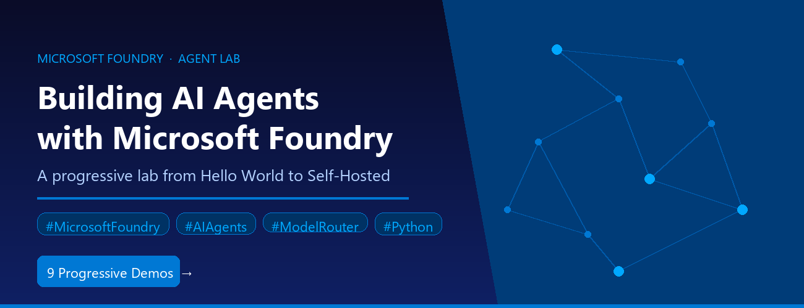

# Microsoft Foundry Agent Demos



A progressive series of demos showing how to build AI agents with the
[Microsoft Foundry SDK](https://learn.microsoft.com/azure/ai-studio/).
Each demo builds on the previous one, adding one new concept at a time.

## Demo Summary

| # | Folder | Description | Concept | Tool | UX | Default Model |
|---|--------|-------------|-------------|------|-----|---------------|
| 0 | `hello-demo/` | Simplest prompt agent — chat in the terminal | Agent creation, conversations, Responses API | None | Terminal | Model Router |
| 1 | `tools-demo/` | Function calling with a live weather API | Function tools, tool-calling loop, live API integration | FunctionTool | Terminal | Model Router |
| 2 | `desktop-demo/` | Same agent, desktop GUI window | Same agent with a different UI (CLI → desktop) | None | Desktop (Tkinter) | Model Router |
| 3 | `websearch-demo/` | Built-in web search with citations | Built-in tools (server-side), no client tool loop needed | WebSearchTool | Terminal | Model Router |
| 4 | `code-demo/` | Code interpreter with Gradio web UI | Code execution in sandbox, web UI with Gradio | CodeInterpreterTool | Web (Gradio) | Model Router |
| 5 | `rag-demo/` | File search grounded in your documents (RAG) | Document upload, vector stores, RAG grounding | FileSearchTool | Terminal | Model Router |
| 6 | `mcp-demo/` | External tools via Model Context Protocol | MCP servers, human-in-the-loop approval, open standard | MCPTool | Terminal | Model Router |
| 7 | `toolbox-demo/` | Centralized tool governance via Toolbox | Toolbox versioning, curated tool subsets, single MCP endpoint | Toolbox (GitHub Issues + Repos) | Terminal | Model Router |
| 8 | `hosted-demo/` | Self-hosted agent with Responses protocol | Custom agent server, streaming, deploy to Foundry container hosting | None (custom server) | Terminal + Agent Inspector | gpt-4.1-mini |

## Model Router — One Model to Rule Them All

All agents in this repo use **`model-router`** as their model deployment. No model pinning, no per-agent model selection, no routing logic in your code:

```
MODEL_DEPLOYMENT=model-router
```

Model Router is a Microsoft Foundry capability that intelligently routes each request to the optimal model in real time — balancing quality, latency, and cost. A simple greeting might be handled by a lightweight model, while a complex tool-calling chain gets routed to a frontier model. You get the best of all available models without deploying or managing any of them individually.

**Key benefits observed across these demos:**
- **Zero model selection overhead** — no need to evaluate which model fits each agent
- **Significant cost efficiency** — simple queries use cheaper models; expensive models only fire when needed
- **Automatic quality routing** — tool-calling, RAG, code generation, and conversational tasks each get the right model
- **Future-proof** — as new models become available, the router picks them up without code changes

For a deep-dive analysis showing which models the router selected for each demo (and why), see **[MODEL-ROUTER.md](MODEL-ROUTER.md)**.

## Features

- **Progressive complexity** — each demo adds exactly one new concept, building on the previous ones
- **One-command launch** — numbered `.bat` files (Windows) and `.sh` files (macOS/Linux) at the root run everything end-to-end using the shared virtual environment
- **Per-demo configuration** — each demo has its own `.env` file with sensible defaults; change one demo without affecting others
- **Session logging** — append `log` to any launch command to capture the full session (input + output) to `chat-log.txt` for slides and documentation
- **GUI and web logging** — desktop (Tkinter) and web (Gradio) demos also log conversations, not just terminal demos
- **Three UX modes** — terminal, desktop, and web interfaces show that the same agent works with any presentation layer
- **Built-in vs function tools** — demos contrast client-side tool execution (Demo 1) with server-side built-in tools (Demos 3–5), open-standard MCP tools (Demo 6), and centralized toolbox governance (Demo 7)
- **Clean reset** — demos 0–7 include `reset.bat` (Windows) and `reset.sh` (macOS/Linux) to delete agents and resources; the hosted demo stops its local server when chat exits
- **Presenter guide** — the root `DEMO-GUIDE.md` covers recommended demo order, time-budget combos, recovery tips, and key messages to land
- **Demo scripts** — every folder includes a `DEMO-SCRIPT.md` with step-by-step talking points and suggested prompts, so presenters can walk through each demo confidently
- **Self-contained documentation** — each demo folder has its own README, HOW-IT-WORKS, and DEMO-SCRIPT
- **Shared dependencies** — one `requirements.txt` and one `.venv` at the root; no per-demo install steps

## Prerequisites

- **Python 3.10+** with a virtual environment
- **Azure subscription** with a Microsoft Foundry project
- **Azure CLI** (`az login` for authentication)

## One-Time Setup

### 1. Clone the repository

```cmd
git clone https://github.com/microsoft-foundry/Foundry-Agent-Lab.git
cd Foundry-Agent-Lab
```

### 2. Create a Python virtual environment

A virtual environment isolates this project's dependencies from your global Python installation.

**Windows (Command Prompt or PowerShell):**
```cmd
python -m venv .venv
```

**macOS / Linux:**
```bash
python3 -m venv .venv
```

> **Tip:** Verify your Python version first with `python --version`. Python 3.10 or higher is required.

### 3. Activate the virtual environment

You must activate the venv before installing packages or running any demo.

| Shell | Command |
|-------|---------|
| Windows Command Prompt | `.venv\Scripts\activate.bat` |
| Windows PowerShell | `.venv\Scripts\Activate.ps1` |
| macOS / Linux (bash/zsh) | `source .venv/bin/activate` |

Your prompt will show `(.venv)` when the environment is active.

> **PowerShell note:** If you see an execution policy error, run `Set-ExecutionPolicy -Scope CurrentUser -ExecutionPolicy RemoteSigned` once, then retry.

### 4. Install dependencies

```cmd
pip install -r requirements.txt
```

All demos share this single install — no per-demo setup required.

### 5. Configure each demo

In each demo folder you plan to run, copy `.env.sample` to `.env` and fill in
your Microsoft Foundry project endpoint:

```cmd
copy hello-demo\.env.sample hello-demo\.env
```

On macOS/Linux:

```bash
cp hello-demo/.env.sample hello-demo/.env
```

Then edit `.env` with your values:

```
PROJECT_ENDPOINT=https://your-resource.ai.azure.com/api/projects/your-project
MODEL_DEPLOYMENT=model-router
```

> Find your `PROJECT_ENDPOINT` on the **Overview** page of your Foundry project in the Azure portal.

### Deactivating the virtual environment

When you are done, deactivate with:

```cmd
deactivate
```

## Running a Demo

```cmd
az login                        (once per session)
0-hello-demo                    (run from repo root)
1-tools-demo
2-desktop-demo
...
```

On macOS/Linux:

```bash
./0-hello-demo.sh
./1-tools-demo.sh
./2-desktop-demo.sh
# Continue with the other numbered .sh launchers.
```

Each launcher runs the demo end-to-end using Python from the repository's
`.venv`, so activation is not required after dependencies are installed.
Scripts also work when launched by absolute path from another directory.
The desktop demo requires Tkinter and a graphical desktop session.
The hosted demo requires port 8088 to be free and stops its server when chat
exits or the launcher is interrupted.

### Logging Output

To capture the full console session to a text file (for slides/docs):

```cmd
0-hello-demo log
```

On macOS/Linux:

```bash
./0-hello-demo.sh log
```

This creates `hello-demo\chat-log.txt` with the complete session transcript
including your input and the agent's responses.

## Project Structure

```
my-agent-demos/
├── requirements.txt          Python dependencies (shared)
├── DEMO-GUIDE.md             Presenter best practices & recommended flows
├── _tee.py                   Console logging utility
├── .gitignore
├── 0-hello-demo.bat          Root launchers (pass-through)
├── 1-tools-demo.bat
├── ...
├── hello-demo/               Demo 0: Basic prompt agent
│   ├── create_agent.py
│   ├── chat.py
│   ├── demo.bat
│   ├── reset.bat
│   ├── .env / .env.sample
│   ├── README.md
│   ├── HOW-IT-WORKS.md
│   └── DEMO-SCRIPT.md
├── tools-demo/               Demo 1: Function calling
├── desktop-demo/             Demo 2: Tkinter GUI
├── websearch-demo/           Demo 3: Built-in web search
├── code-demo/                Demo 4: Code interpreter + Gradio
├── rag-demo/                 Demo 5: File search / RAG
│   └── data/                 Sample documents
├── mcp-demo/                 Demo 6: MCP integration
├── toolbox-demo/             Demo 7: Centralized toolbox
└── hosted-demo/              Demo 8: Self-hosted agent (Responses protocol)
    ├── main.py
    ├── chat.py
    ├── demo.bat
    ├── agent.yaml
    ├── Dockerfile
    ├── .env
    ├── README.md
    ├── HOW-IT-WORKS.md
    └── DEMO-SCRIPT.md
```

## Configuration

Each demo has its own `.env` file with three variables:

| Variable | Purpose |
|----------|---------|
| `PROJECT_ENDPOINT` | Your Foundry project endpoint (required) |
| `AGENT_NAME` | Name registered in Foundry (has a sensible default) |
| `MODEL_DEPLOYMENT` | Model to use (default: `model-router`) |

## Cleanup

Demo folders 0–7 include `reset.bat` and `reset.sh` scripts that delete the
agent (and associated resources like vector stores). Use them if a demo crashes mid-run
or you want a clean slate:

```cmd
hello-demo\reset.bat
tools-demo\reset.bat
```

On macOS/Linux:

```bash
./hello-demo/reset.sh
./tools-demo/reset.sh
```

## Dependencies

All demos share one `requirements.txt`:

- `azure-ai-projects` — Agent creation and management
- `azure-identity` — Azure authentication
- `python-dotenv` — Environment variable loading
- `requests` — HTTP calls (weather API in Demo 1)
- `gradio` — Web UI (Demo 4 only)
- `azure-ai-agentserver-responses` — Hosted agent server (Demo 8 only)

## Contributing

Contributions are welcome! Please read [CONTRIBUTING.md](CONTRIBUTING.md) for guidelines on how to
submit pull requests, report issues, and follow the Microsoft Open Source Code of Conduct.

## Security

This repo uses `DefaultAzureCredential` — no API keys in code. Never commit `.env` files.
To report a security vulnerability, see [SECURITY.md](SECURITY.md).

## License

This project is licensed under the [MIT License](LICENSE).

Copyright (c) 2026 Microsoft Corporation.
